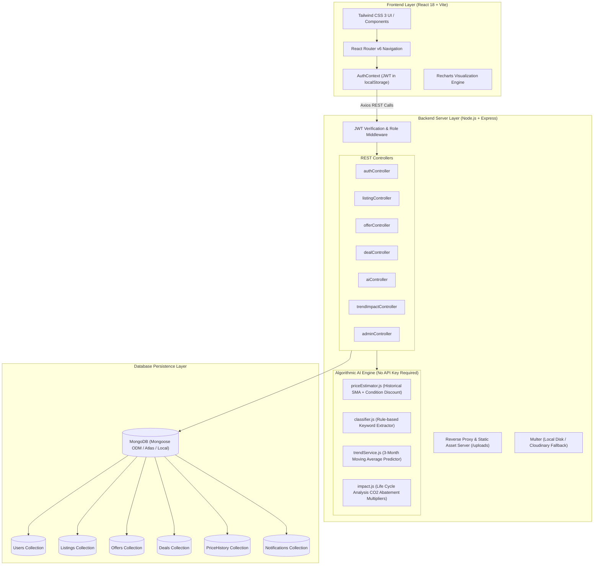

# Fluxora — System Architecture & Component Design

## 1. High-Level Architecture Overview

Fluxora utilizes a **3-Tier MERN Architecture** (Client, Application/REST API Server, Database) augmented with algorithmic AI services with zero external paid dependencies.

---

## 2. Key Subsystems

### 2.1 Authentication & Authorization Subsystem
- **Standard:** Stateless JSON Web Token (JWT) with HMAC-SHA256 signature.
- **Expiry:** 7 days.
- **Role Verification:** Express middleware checks `req.user.role` (`seller`, `buyer`, `admin`) prior to granting route access.
- **Account Protection:** `isBlocked` flag check stops revoked users at login and token validation.

### 2.2 Scrap Listing & Haversine Distance Search Subsystem
- **Nearby Algorithm:** Uses the spherical law of cosines / Haversine formula in pure JavaScript:
  $$\Delta\sigma = 2 \arcsin \sqrt{\sin^2\left(\frac{\Delta\phi}{2}\right) + \cos\phi_1 \cos\phi_2 \sin^2\left(\frac{\Delta\lambda}{2}\right)}$$
  $$d = R \cdot \Delta\sigma \quad (\text{where } R = 6371\text{ km})$$
- Zero dependency on external GIS database engines or paid map APIs.

### 2.3 Negotiation & Offer Workflow Subsystem
1. Buyer submits offer: `{ offeredPrice, quantity, message }`
2. Seller reviews in Offers Inbox:
   - **Accept:** Marks listing as `sold`, generates confirmed `Deal`, calculates carbon abatement.
   - **Counter:** Proposes revised unit price back to buyer.
   - **Reject:** Closes offer without deal creation.
