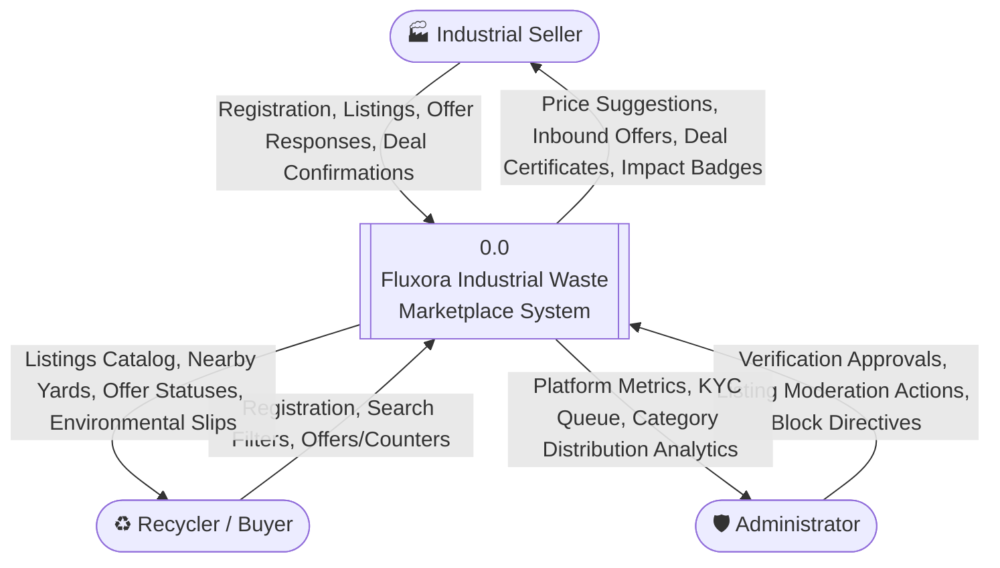
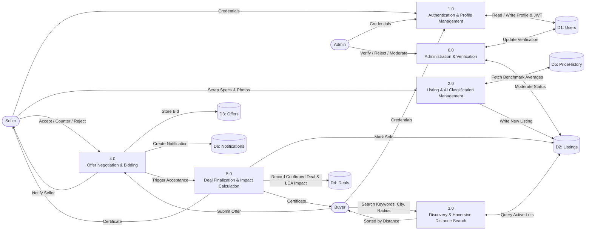

# Fluxora — Data Flow Diagrams (DFD)

## 1. DFD Level 0 (Context Diagram)

The Level 0 context diagram demonstrates the high-level boundary of the Fluxora system interacting with its three external entities: **Industrial Seller**, **Scrap Recycler (Buyer)**, and **Platform Administrator**.

---

## 2. DFD Level 1 (Detailed Subsystem Flow)

The Level 1 diagram breaks the central process down into major subprocesses and displays data store interactions.

