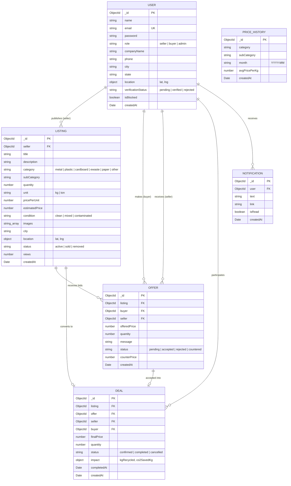

# Fluxora — Entity Relationship (ER) Diagram

Fluxora maintains **6 collections** in MongoDB designed for relational integrity via Mongoose ObjectIds while retaining document scalability.

---

## Data Dictionary

| Collection | Cardinality & Relationships | Purpose |
|---|---|---|
| **User** | 1-to-N with Listings, Offers, Deals, Notifications | Manages profiles, authentication credentials, roles, and admin KYC status. |
| **Listing** | Belongs to 1 Seller; 1-to-N with Offers; 1-to-1 with Deals | Stores scrap lot specifications, condition, GPS location, and asking prices. |
| **Offer** | Belongs to 1 Listing, 1 Buyer, and 1 Seller | Tracks digital bidding, price negotiations, and counter-proposals. |
| **Deal** | Belongs to 1 Listing, 1 Offer, 1 Seller, and 1 Buyer | Records verified transactions, finalized prices, and LCA carbon savings. |
| **PriceHistory** | Standalone benchmark timeseries | 12-month historical rates per category used for AI price estimation & Recharts trends. |
| **Notification** | Belongs to 1 User | Push alert feed for bid notifications, acceptance, and system updates. |
