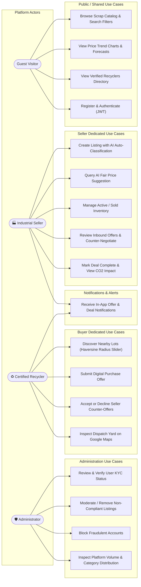

# Fluxora — Use Case Diagram & Actor Specifications

## 1. Actors in Fluxora

1. **Seller (Industrial Scrap Generator):**
   - Manufacturing companies, fabrication facilities, automotive component makers, and mills looking to liquidate scrap without middleman commission.
2. **Buyer (Recycler / Scrap Dealer):**
   - Certified recyclers, foundries, smelters, and re-processors seeking consistent raw scrap supplies nearby.
3. **Administrator:**
   - Platform overseer responsible for KYC document reviews, user status verification, and listing moderation.
4. **Guest / Public Visitor:**
   - Browses marketplace catalog, views recyclers directory, and checks market price trends.

---

## 2. Mermaid Use Case Diagram

